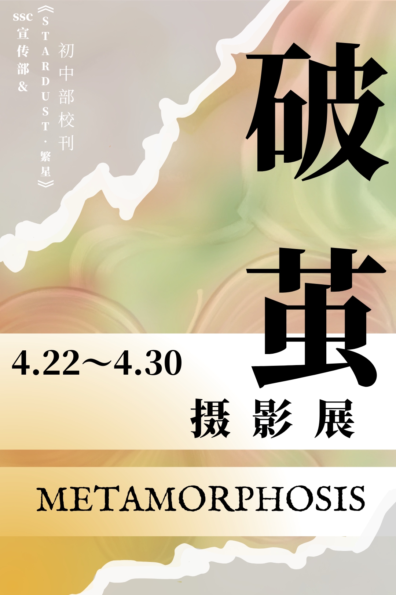
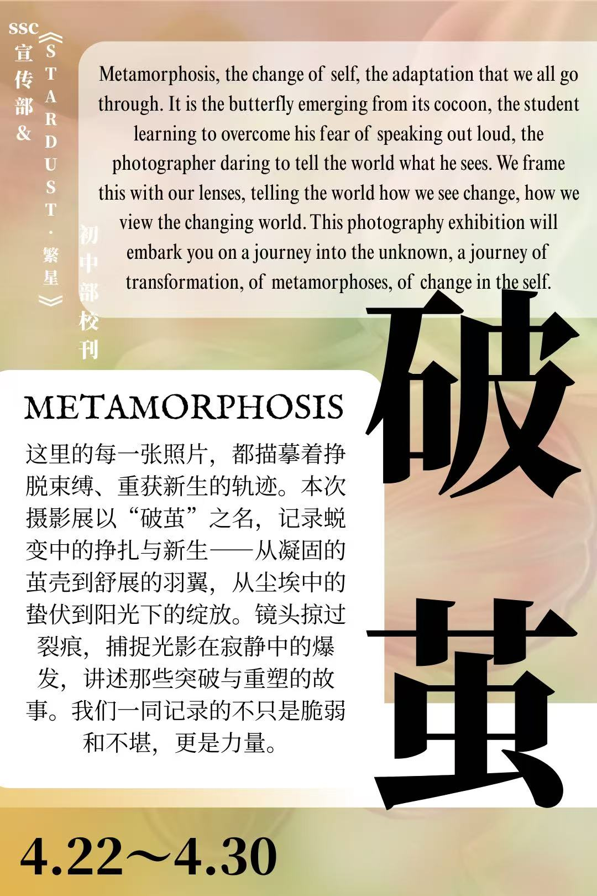
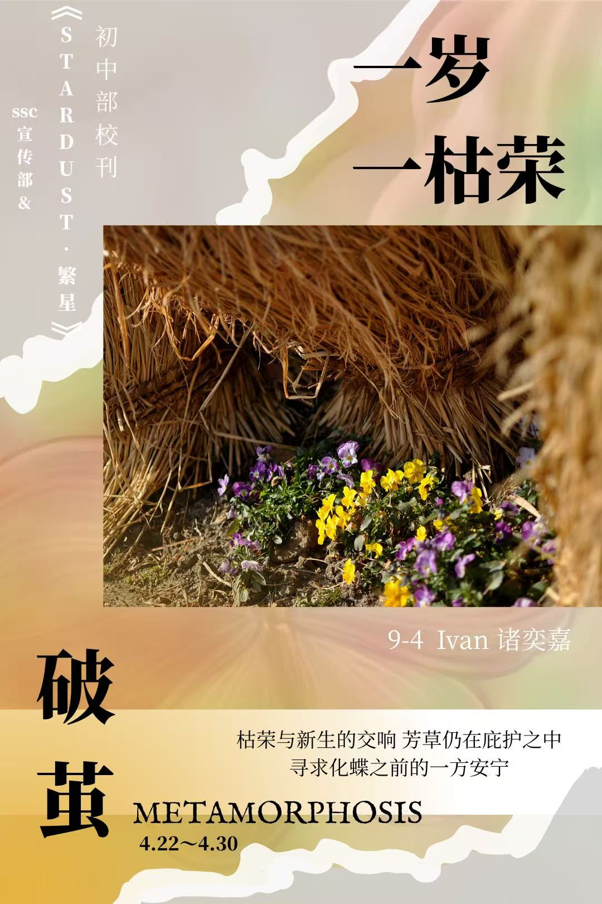
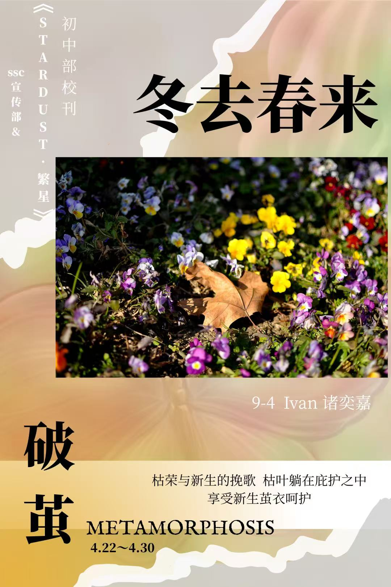
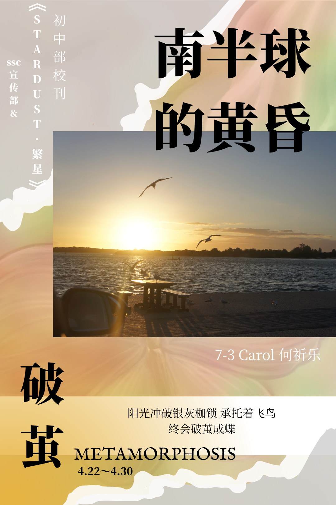
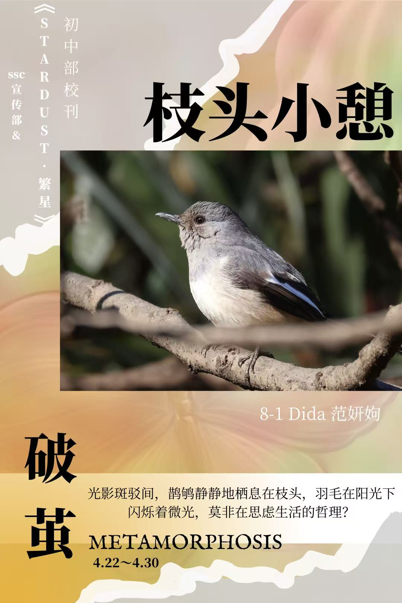
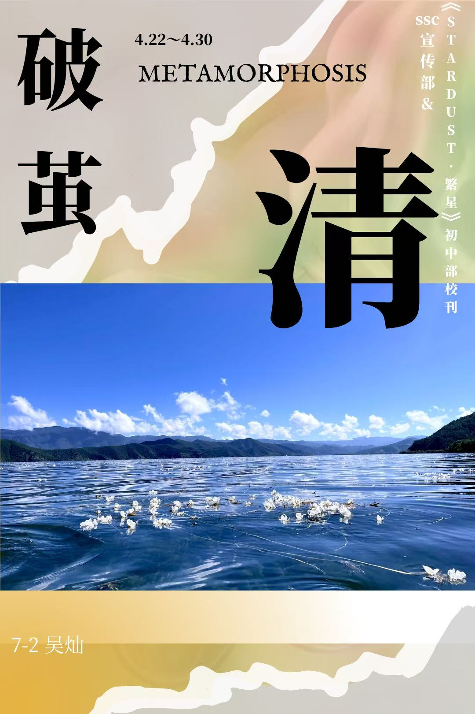
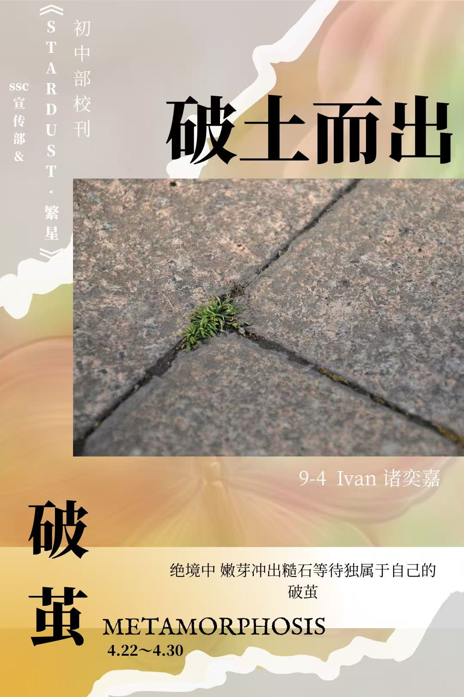
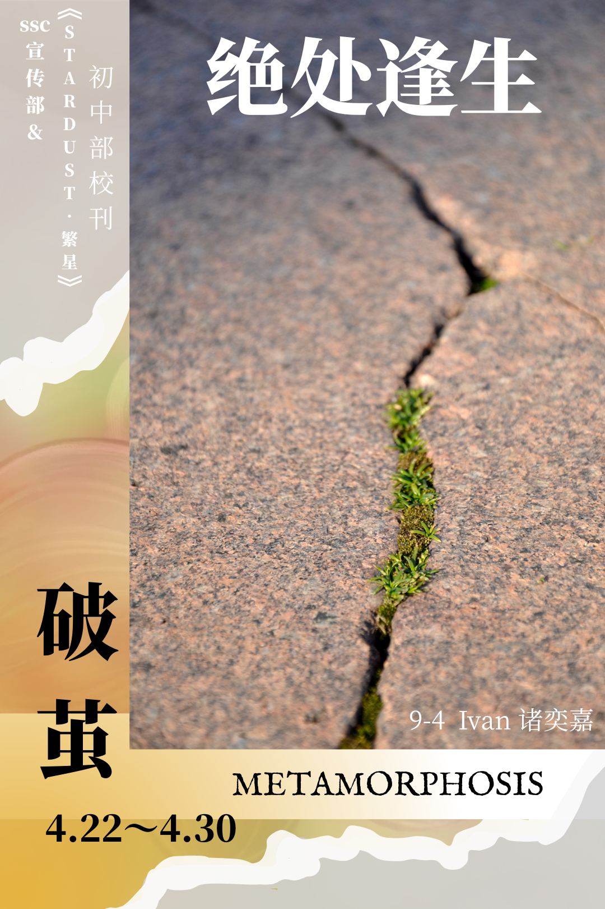
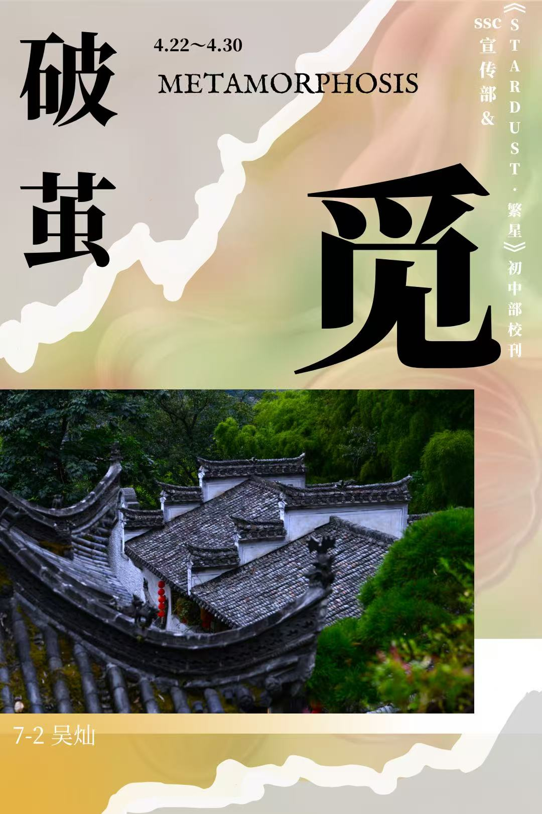

## Breaking the Cocoon — A Photography Exhibition Review

This exhibition is titled **"Breaking the Cocoon"** (破茧).

From the seasonal ebb and flow of grasses and trees, to a gentle glow on the horizon of the Southern Hemisphere; from the stillness of a bird at rest on a branch, to the stubborn vitality of a sprout pushing through barren ground — the lens gradually pulls us away from the everyday and invites us to look again at the small worlds we habitually overlook.

Here are the works from the show:





## A Few Thoughts

Looking back at this series of works, there are still traces of immaturity: the composition isn't always just right, and in a few places the light didn't quite catch the moment. But then again, what beginning isn't just like this — a matter of **doing it first**?

Don't wait until everything is perfectly in place before you start. Lift the camera first, press the shutter first, capture whatever moves you — even if it's rough, even if it's raw. Walk a little more, shoot a little more, and gradually you'll come to understand: what deserves to stay in the frame, and what should be let go.

"Breaking the Cocoon" is not just the name of this series of photographs. It's probably how anything worthwhile starts: start doing it, and let maturity follow.
