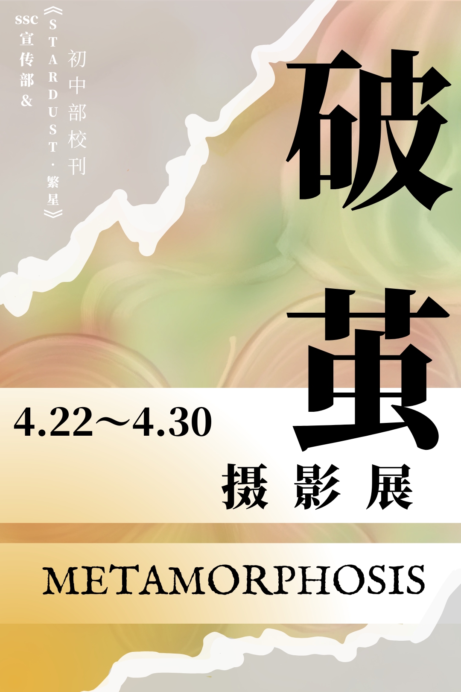
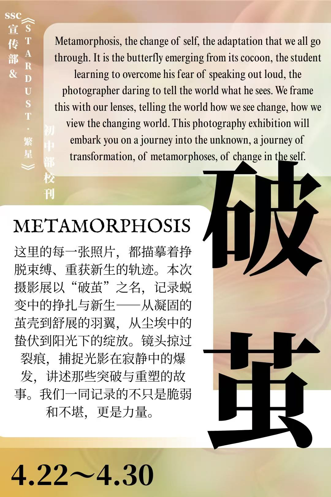
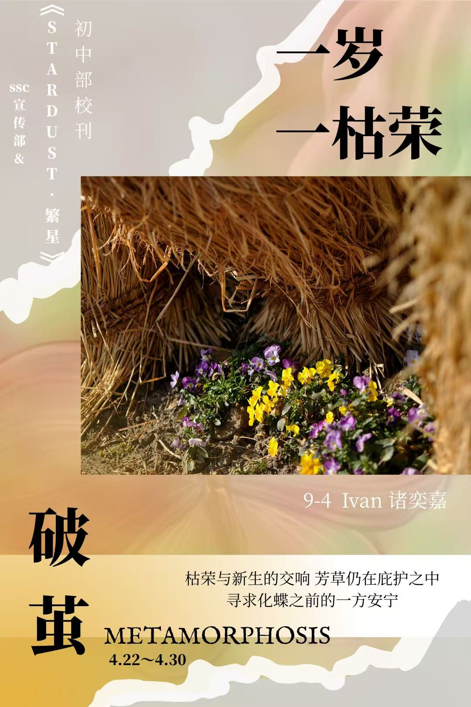
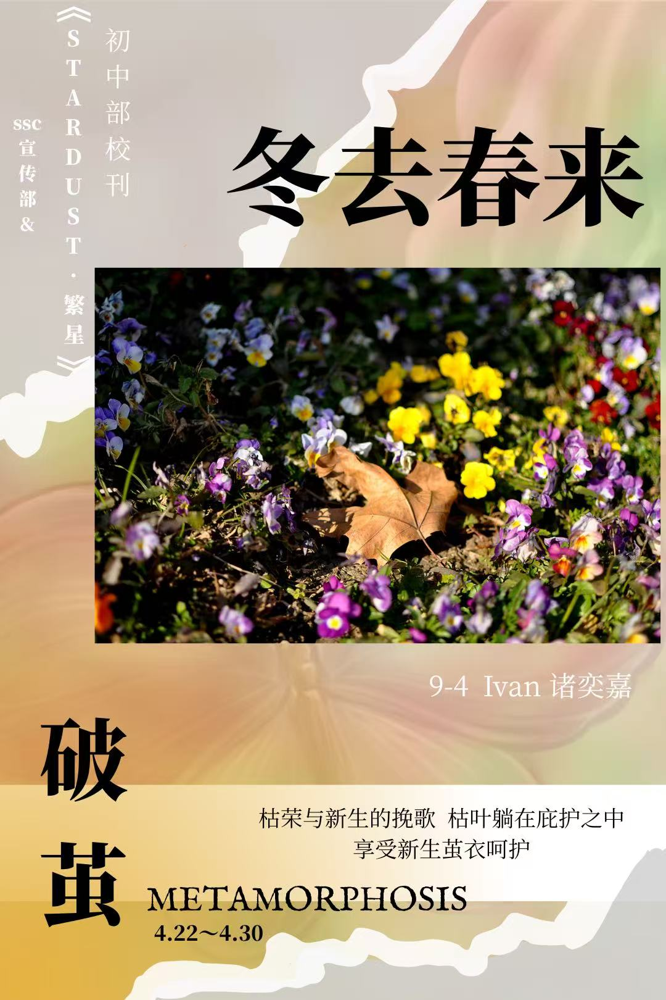
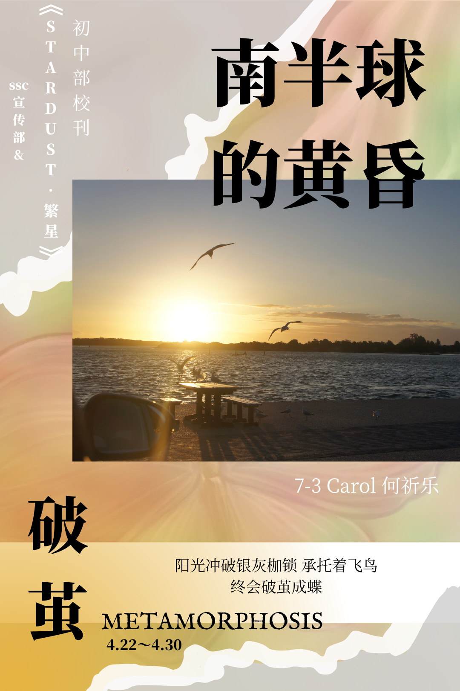
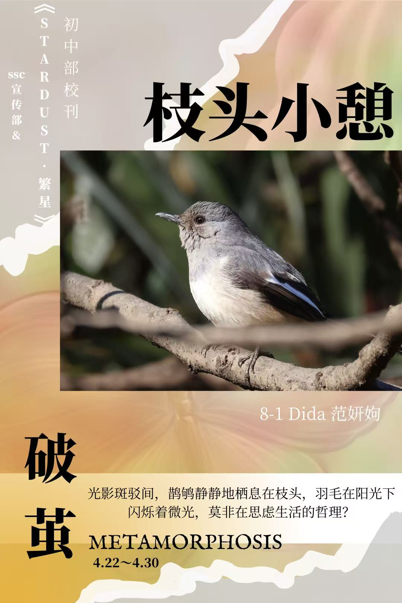
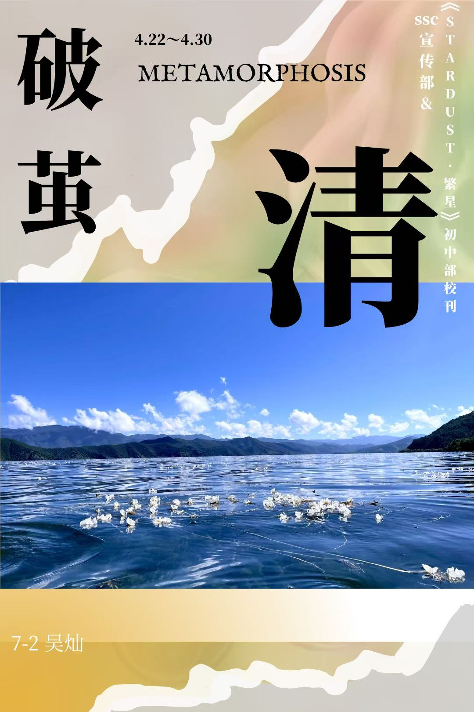
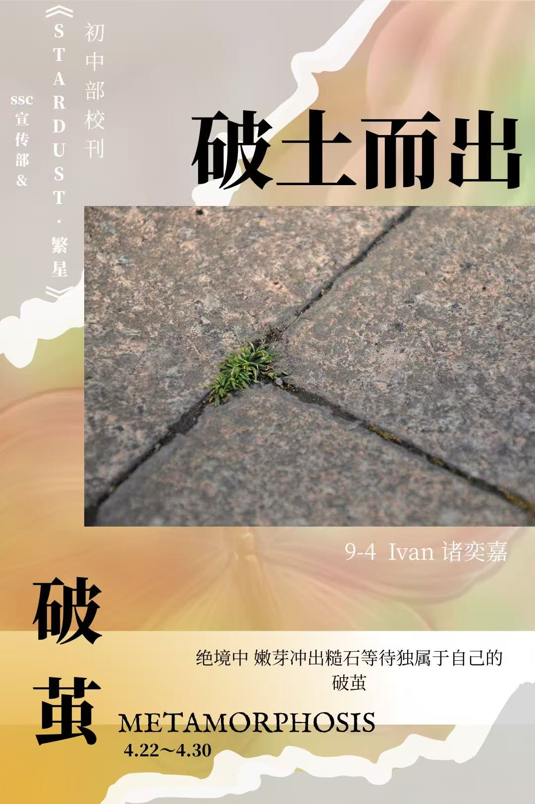
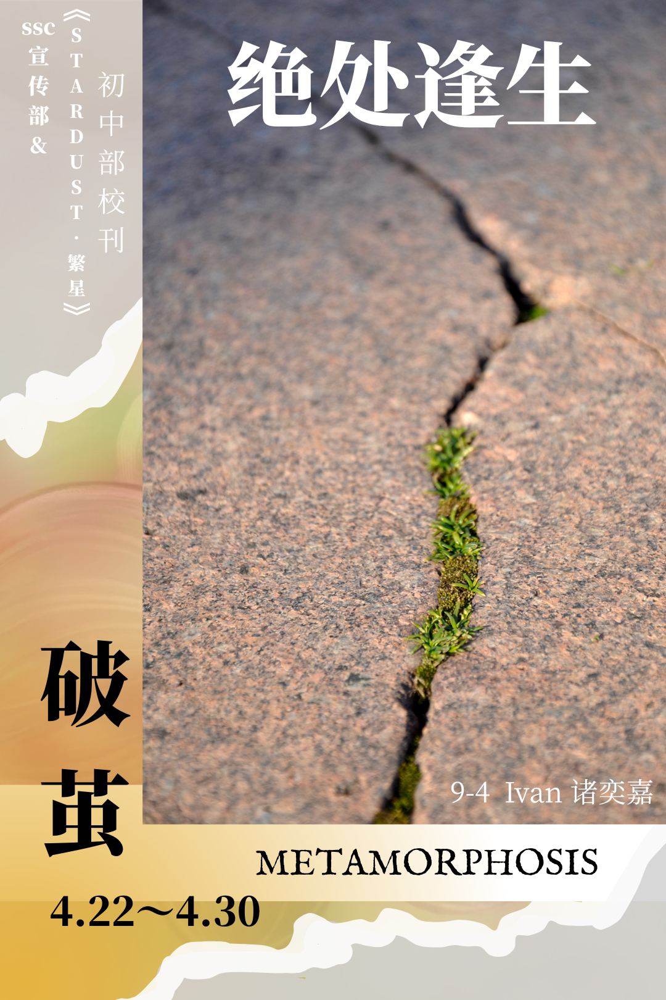
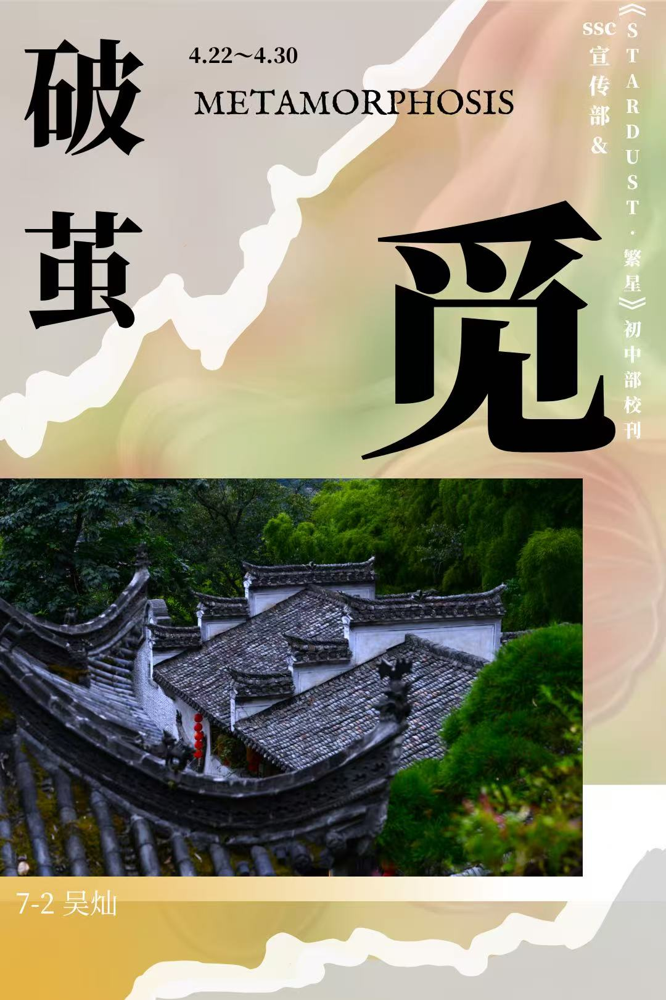

## 「破茧」摄影展回顾

这次摄影展的主题是 **「破茧」**。

从一岁一枯荣的草木更替，到南半球地平线上一抹温柔的黄昏；从枝头小憩的宁静瞬间，到破土而出、绝处逢生的倔强——镜头一点点把我们带离日常，重新看见周遭那些常常被忽略的小世界。

下面是这次展览中的作品回顾：





## 一点感想

回头再看这一组作品，其实还带着点稚嫩的痕迹：构图未必都恰到好处，光线也有几处没能抓住最好的瞬间。但换个角度想，哪一次启程不是从这样的「做起来」开始的？

不必等到万事俱备再动手。先举起相机，先按下快门，先把那些打动自己的瞬间收进来——哪怕粗糙，哪怕生涩。多走几步，多拍几次，自然就会慢慢知道：什么值得留在画面里，什么应该放掉。

「破茧」不只是这组照片的名字，大概也是做任何一件事的样子：先做起来，再逐渐成熟。
